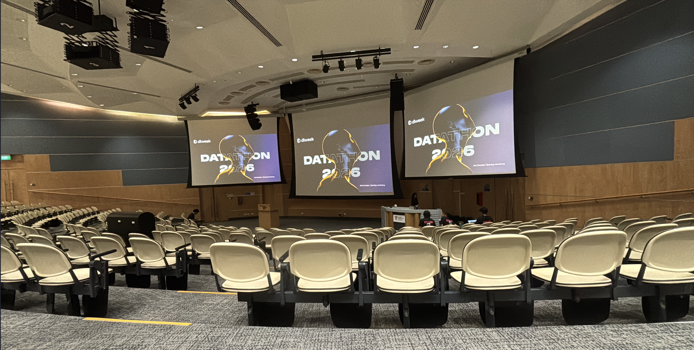
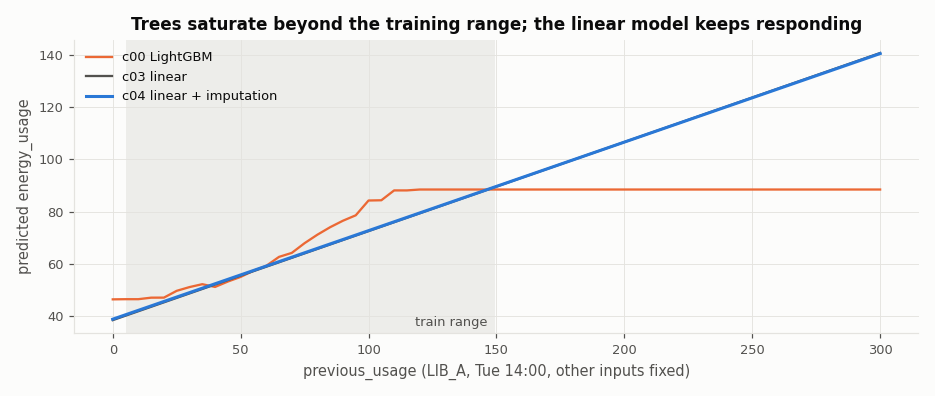
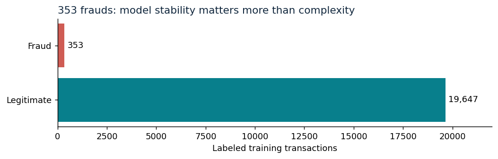
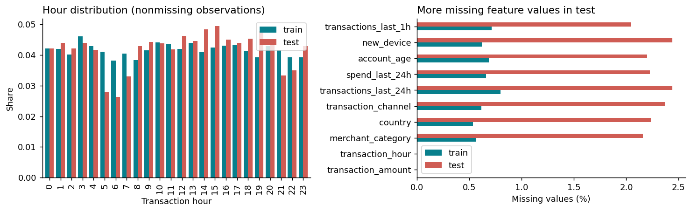
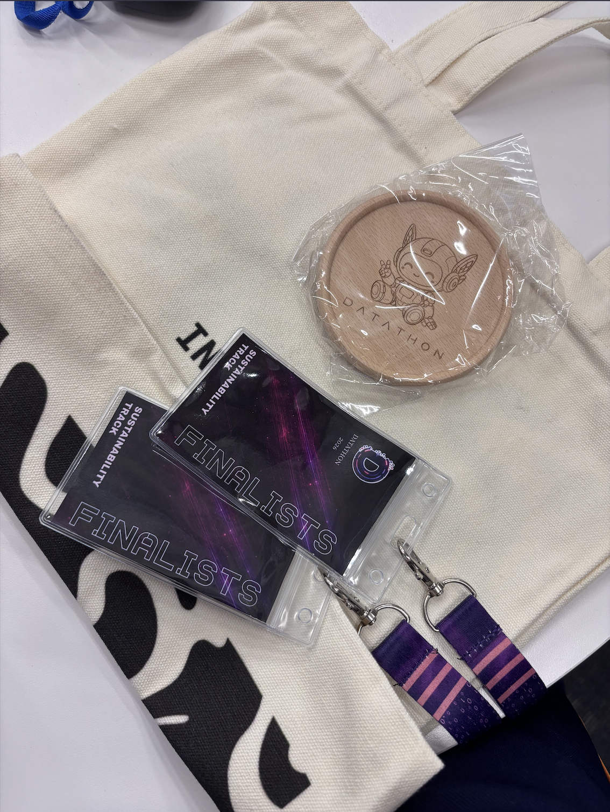
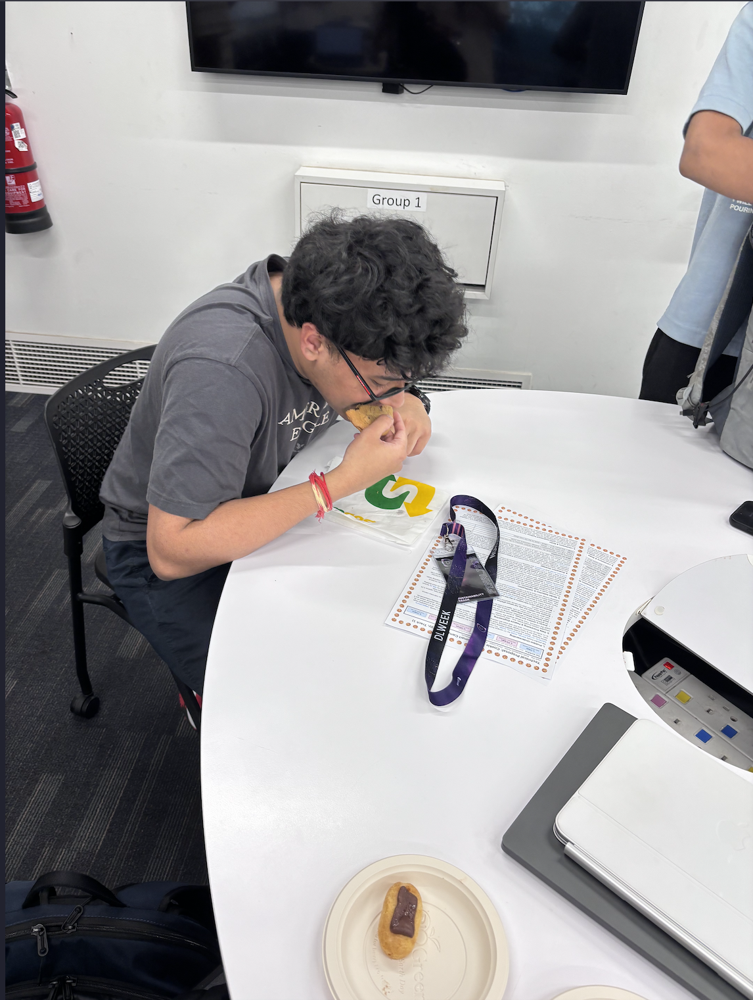

<div align="center">

# Cookie Squad · NTU MLDA Datathon 2026

**Team:** Yash Raj · Anish Gajulapalli Reddy · Dhruv Gupta · Suraj Balaji Bangarusamy

**Smart Campus Energy Forecasting & TrustGuard Fraud Detection**

Two tracks, two different prediction problems, and a shared lesson: understanding the data mattered as much as choosing the model.

**3–4 October 2026 · Nanyang Technological University, Singapore**



</div>

This repository brings together Cookie Squad's work on **Track 1: Smart Campus Analytics** and **Track 2: TrustGuard**. It includes exploratory analysis, feature engineering, training notebooks, saved model packages, experiments, and technical reports.

[Track 1](#track-1--smart-campus-energy-forecasting) · [Track 2](#track-2--trustguard-fraud-detection) · [Run the notebooks](#run-the-notebooks) · [Submissions](#submissions)

## Final standings

| Track | Challenge | Public leaderboard | Overall result | Best reported public score |
| --- | --- | --- | --- | --- |
| **Track 1** | Hourly campus energy forecasting | **3rd** | **Top 5 overall** | **≈ 3.127 RMSE** ↓ |
| **Track 2** | Transaction fraud detection | **4th** | Overall rank not received | **0.24174 PR-AUC** ↑ |

Placements are the team's final standings. Scores come from the final technical reports and experiment records; Track 1's final score is reported to three decimal places. Public leaderboard scores and overall judging results are separate outcomes.

## Track 1 — Smart Campus Energy Forecasting

### The challenge

Predict hourly `energy_usage` from a building's identity, time, weather, occupancy, and previous usage. The dataset contains **8,000 labelled training rows**, **3,000 public test rows**, and **12 campus buildings across 8 building types**. The evaluation metric is **RMSE**, where lower is better.

The rows have no chronological ordering, so we treat each observation independently. The difficult part was the change in input quality: numeric inputs were missing in roughly **6–7% of test rows**, compared with about **1.5% in training**, and the test set contained more extreme values and correlated sensor gaps.

### Our approach

The final report describes a structured linear energy model supported by learned gap-fillers and targeted missing-value corrections:

1. **Clean the inputs.** Convert invalid values and sentinels into missing values, normalise categories, and recover known building types where possible.
2. **Fill sensor gaps.** Average three LightGBM imputers for each missing numeric input. These models use labelled-training features and unlabelled public-test features, a train/test domain flag, and mask augmentation. They never use test energy labels.
3. **Predict energy with ridge regression.** Use **301 engineered features** and regularisation `α = 3`: building-specific base loads, occupancy and temperature slopes, building-type daily profiles, previous usage, humidity, weekend effects, and seasonal terms.
4. **Correct missing-input bias.** Apply small offsets for missing previous usage and occupancy, reflecting the tendency of the filled values to underpredict energy in these cases.
5. **Adjust rows with multiple gaps.** For the **231 public-test rows with at least two missing inputs**, move the prediction away from a separate missing-at-random baseline:

   ```text
   final_prediction = base_prediction + 1.0 × (base_prediction − MAR_baseline)
   ```

The final step was selected using public leaderboard feedback. Its benefit depends on the hidden data having a similar missingness mechanism; it is not supported by randomly masking otherwise observed inputs.

### Why this model worked

Building energy was well described by additive effects, while each building had a distinct schedule and sensitivity to occupancy and temperature. Ridge regression preserved those relationships and continued responding to extreme observed inputs. Tree models tended to saturate beyond their training range.



*An analysis illustration showing why extrapolation mattered when choosing the energy-model family.*

### Results

| Evaluation | RMSE ↓ | What it measures |
| --- | --- | --- |
| Ridge model, complete training rows | **≈ 2.99** | Repeated five-fold cross-validation of the energy model |
| Ridge + test-aware gap-filling + offsets | **≈ 3.186** | Public leaderboard result before the multi-gap adjustment |
| Final pipeline with the multi-gap adjustment | **≈ 3.127** | Final reported public leaderboard result |

The complete-row validation score measures the energy model with observed inputs. It does not measure the full pipeline under the test set's missingness and distribution shift.

**Outcome: 3rd on the public leaderboard and Top 5 overall in Track 1.**

Explore the [Track 1 workspace](Track%201/), [training and analysis notebook](Track%201/notebooks/track1_analysis_presentation.ipynb), and [final technical report](Technical%20Reports/Track1_Technical_Report_CookieSquad.pdf).

## Track 2 — TrustGuard Fraud Detection

### The challenge

Rank transactions by fraud risk while keeping false alarms manageable. The dataset contains **20,000 training transactions**, **12,000 public test transactions**, and only **353 labelled frauds**, a training fraud rate of **1.765%**.

An always-legitimate classifier would achieve 98.235% training accuracy while detecting no fraud. We therefore focused on **PR-AUC**, where higher is better, and used precision, recall, and review workload to understand the operating point.

### Our approach

We built a regularised logistic ensemble with features that express transaction context:

- **Relative amounts:** log transaction amounts compared with merchant-category, channel, and country medians, plus recent average spending.
- **Activity and account age:** transaction-velocity thresholds, burst indicators, and young-account flags.
- **Combined risk signals:** new device × night and new device × account age, alongside pairwise feature interactions.
- **Similarity to known cases:** a nearest-neighbour distance ratio comparing each transaction with stored fraud and legitimate training references, excluding self-matches during training.

The three members are combined on the **log-odds scale**:

| Model member | Role | Blend weight |
| --- | --- | --- |
| Engineered logistic regression + nearest-neighbour feature | Contextual amounts, activity, device signals, and similarity | **56%** |
| Pairwise-interaction logistic regression | Combinations of risk factors | **24%** |
| Threshold-basis logistic regression (GALR) | Step changes in amount, account age, and activity | **20%** |

Regularisation was particularly useful with only 353 positive examples. The tested tree and neural alternatives did not improve on this feature-driven ensemble.

### Handling distribution shift

Activity bursts occurred about **3.1 times as often in test**, and mean feature missingness increased from **0.52% to 1.81%**. Hour and feature patterns also suggested synthetic-looking transaction groups. These observations motivated fixed group adjustments for bursts, older accounts using new devices, and selected high-value purchases.





The final **C2** variant refined burst adjustments by country, distinguishing Malaysia, Indonesia, and Singapore from other countries. These adjustments were selected with public leaderboard feedback, so their transfer to a different population remains uncertain.

### Results

| Stage | Public PR-AUC ↑ |
| --- | --- |
| Earlier single logistic regression | **0.17206** |
| Engineered logistic regression + nearest-neighbour feature | **0.18626** |
| Three-member ensemble with group adjustments (R2op) | **0.23434** |
| Final country-aware burst adjustment (C2) | **0.24174** |

Fresh cross-validation of the base blend achieved approximately **0.251 average precision**, before the test-specific group adjustments. This is a training-distribution result and should be read separately from the public score.

For the decision threshold, a fixed global logit shift placed roughly the top **2.5%** of public-test transactions above 0.5 without changing their ranking or PR-AUC. The outputs are **decision scores in `[0, 1]`**, not calibrated fraud probabilities.

**Outcome: 4th on the public leaderboard. An overall Track 2 rank was not received.**

Explore the [Track 2 workspace](Track%202/), [training and analysis notebook](Track%202/analysis/Track2_Judge_Analysis.ipynb), and [final technical report](Technical%20Reports/Track2_TrustGuard_Technical_Report_CookieSquad.pdf).

## Repository guide

```text
.
├── README.md
├── Imgs/                         All README images: event photos and analysis plots
├── Technical Reports/            Final team reports for both tracks
├── Track 1/
│   ├── notebooks/                Training, analysis, and presentation notebook
│   ├── src/                      Features, models, training, and experiments
│   ├── package/                  Saved model bundles and inference notebooks
│   ├── submissions/              Prediction CSVs for candidate models
│   └── reports/                  Analysis figures and earlier reports
└── Track 2/
    ├── analysis/                 Training notebook and analysis figures
    ├── src/                      Features, models, validation, and experiments
    ├── packages/                 Saved model bundles and inference notebooks
    ├── submissions/              Prediction CSVs and leaderboard probes
    └── docs/                     Earlier technical documentation
```

**Stack:** Python · NumPy · pandas · SciPy · scikit-learn · LightGBM · Jupyter · Matplotlib

## Run the notebooks

Use **Python 3.12** and the pinned dependencies provided by each track. Run the following from the repository root:

```bash
python3.12 -m venv .venv
source .venv/bin/activate
python -m pip install -r "Track 1/requirements-image.txt"
python -m pip install -r "Track 2/requirements-image.txt"
python -m pip install jupyter nbconvert ipykernel
```

On Windows, activate the environment with `.venv\Scripts\Activate.ps1` instead.

Open the training notebooks from their respective track directories so they can find the supplied `train.csv`, `test.csv`, and source modules:

```bash
# Track 1
cd "Track 1"
jupyter notebook notebooks/track1_analysis_presentation.ipynb

# Track 2, in a separate terminal from the repository root
cd "Track 2"
jupyter notebook analysis/Track2_Judge_Analysis.ipynb
```

The training notebooks rebuild models and explain the experiments. Each saved package also contains a separate **inference-only** `prediction_notebook.ipynb` that loads its neighbouring `model.pkl`. Those notebooks accept `DATATHON_INPUT_PATH` and `DATATHON_OUTPUT_PATH`, defaulting to `test.csv` and `predictions.csv`.

## From the datathon

<table>
  <tr>
    <td align="center" width="50%">
      
    </td>
    <td align="center" width="50%">
      
    </td>
  </tr>
  <tr>
    <td align="center" width="50%">
      
    </td>
    <td align="center" width="50%">
      
    </td>
  </tr>
</table>

## Submissions

Both tracks' final technical reports, training notebooks, and one saved trained model per track are linked below.

**Archive versions:** the available Track 1 notebook and model reproduce the **c18_private_safe / c17** pipeline, which predates the final multi-gap adjustment. The Track 2 notebook and saved bundle reproduce **R2op**, before the final **C2** country adjustment in inference. The final technical reports document the later competition submissions and their results.

| Track | Final technical report | Training notebook | Trained model (`.pkl`) |
| --- | --- | --- | --- |
| **Track 1 — Smart Campus** | [Track 1 report (PDF)](Technical%20Reports/Track1_Technical_Report_CookieSquad.pdf) | [Training & analysis notebook](Track%201/notebooks/track1_analysis_presentation.ipynb) | [c18_private_safe model.pkl](Track%201/package/c18_private_safe/model.pkl) |
| **Track 2 — TrustGuard** | [Track 2 report (PDF)](Technical%20Reports/Track2_TrustGuard_Technical_Report_CookieSquad.pdf) | [Training & analysis notebook](Track%202/analysis/Track2_Judge_Analysis.ipynb) | [R2op model.pkl](Track%202/packages/codex_r2op_reviewed/model.pkl) |
